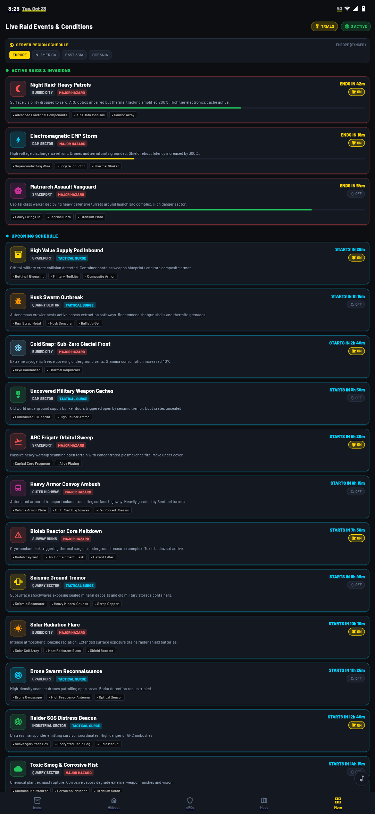
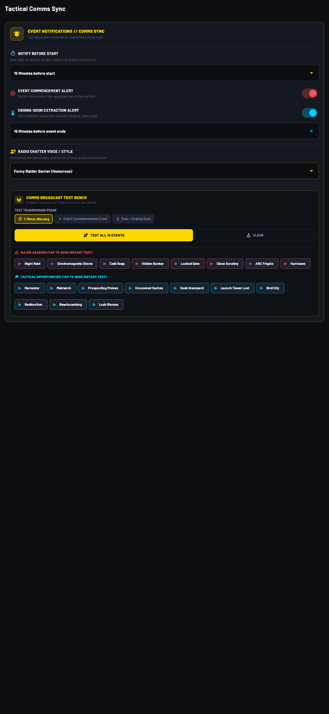
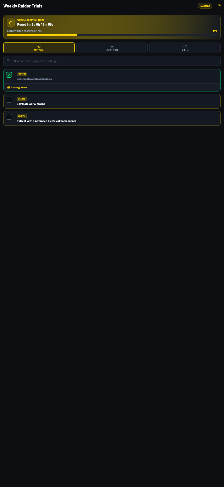
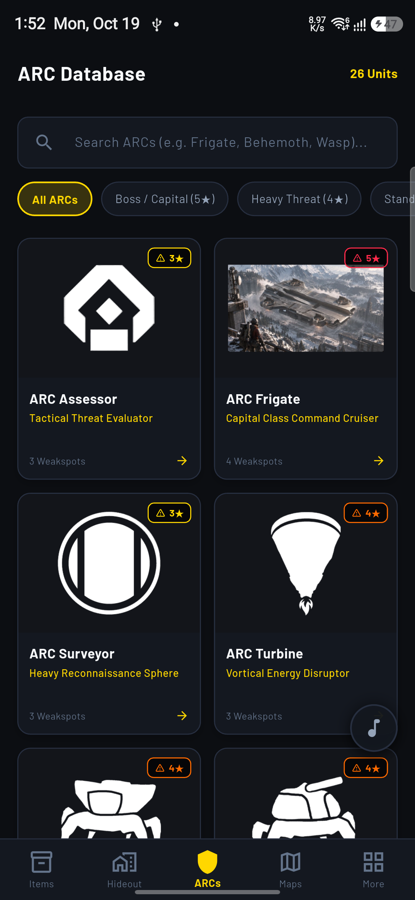
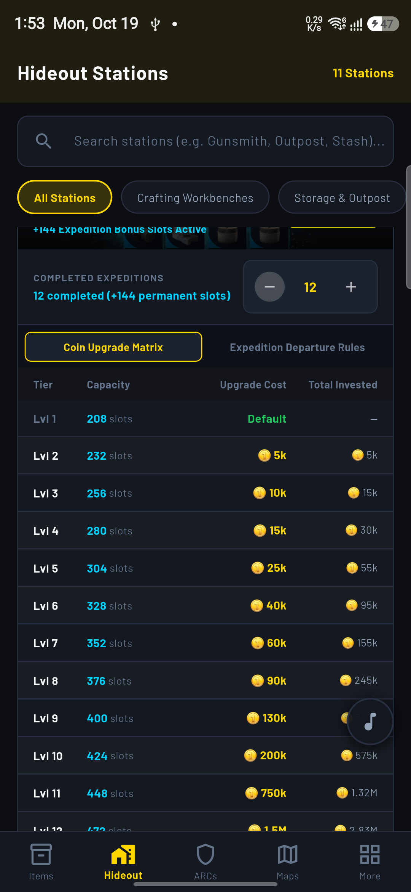
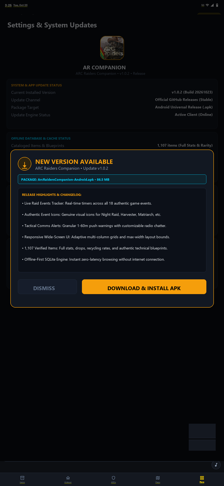

<p align="center">
  
</p>

<h1 align="center">⚡ ARC Raiders Companion</h1>

<p align="center">
  <b>The Definitive Tactical Field Guide, Live Raid Timers, Interactive Workshop & Bestiary for ARC Raiders</b>
</p>

<p align="center">
  <a href="https://github.com/xDPixel/AR-Companion-Releases/releases/latest"></a>
  <a href="#"></a>
  <a href="#"></a>
  <a href="#"></a>
  <a href="#"></a>
  <a href="#"></a>
</p>

---

<div align="center">

### 🛡️ 100% Free Community Project • Absolutely Zero Ads • No Paywalls • Zero User Tracking
*Engineered by players, for players. Everything inside ARC Raiders Companion is unlocked, offline-capable, and completely free.*

</div>

---


## 📥 Official Downloads (Latest Release: v1.0.3)

All packages are compiled natively for their target operating systems. Choose your platform below for instant, direct downloads:

| Platform | Package File | Architecture | Size | Direct Download |
| :--- | :--- | :---: | :---: | :---: |
|  **Windows** | `ArcRaidersCompanion-Windows.exe` | Inno Setup Installer (x64) | `39.0 MB` | [⬇️ Download Installer (.exe)](https://github.com/xDPixel/AR-Companion-Releases/releases/download/v1.0.3/ArcRaidersCompanion-Windows.exe) |
|  **Android** | `ArcRaidersCompanion-Android.apk` | Universal Release APK | `86.5 MB` | [⬇️ Download Android (.apk)](https://github.com/xDPixel/AR-Companion-Releases/releases/download/v1.0.3/ArcRaidersCompanion-Android.apk) |
|  **iOS** | `ArcRaidersCompanion-iOS-unsigned.ipa` | Sideloadable Package | `51.1 MB` | [⬇️ Download iOS (.ipa)](https://github.com/xDPixel/AR-Companion-Releases/releases/download/v1.0.3/ArcRaidersCompanion-iOS-unsigned.ipa) |
|  **macOS** | `ArcRaidersCompanion-macOS.dmg` | Disk Image (.dmg Universal) | `55.1 MB` | [⬇️ Download macOS (.dmg)](https://github.com/xDPixel/AR-Companion-Releases/releases/download/v1.0.3/ArcRaidersCompanion-macOS.dmg) |
|  **Linux** | `ArcRaidersCompanion-Linux-x64.tar.gz` | Desktop Bundle (x86_64) | `39.3 MB` | [⬇️ Download Linux (.tar.gz)](https://github.com/xDPixel/AR-Companion-Releases/releases/download/v1.0.3/ArcRaidersCompanion-Linux-x64.tar.gz) |

---

## 🌟 Comprehensive Feature Showcase

### 1. 🛡️ Armory Compendium & Blueprint Schematics Database
> Instant multi-facet search, authentic in-game inventory dimensions, full rarity spectrum, recycling yields, and technical blueprint schematics.

<p align="center">
  
  
</p>

- **Over 1,100 Cataloged Items**: Exhaustive database covering ballistic firearms, heavy ordnance, energy ammunition, tactical shields, healing stims, crafting raw materials, and security keycards.
- **Authentic Stash Inventory Grids**: True-to-game inventory slot dimensions (1×1, 1×2, 2×2, 2×3) so you know exactly how much space your gear occupies in your backpack.
- **Dedicated Blueprint Technical Schematics**: Technical blue grid view spotlighting craftable weapon variants, attachments, and mods.
- **Lore-Accurate Rarity Hierarchy**: Common (Grey), Uncommon (Green), Rare (Blue), Epic (`#CC3199` Neon Magenta), and Legendary (Gold).
- **Recycling & Salvage Ratios**: Tap any equipment to see exact scrap outputs, polymer yields, and trader valuation comparisons.

---

### 2. ⏱️ Live Raid Event Timers & Server Regions
> Real-time surface invasion tracker with countdown clocks, active status indicators, and multi-region filtering.

<p align="center">
  
</p>

- **Real-Time Synchronized Clocks**: Live countdown clocks tracking active surface storm cycles, locked gates, and aerial incursions across all 18 authentic game events.
- **Global Server Regions**: Switch between Europe, North America, East Asia, Oceania, and South America for server-precise raid schedules.
- **Hazard Tier Classification**: Clear distinction between **Major Hazards** (*Night Raid*, *Electromagnetic Storm*, *Locked Gate*, *ARC Frigate*, *Cold Snap*, *Close Scrutiny*, *Hurricane*, *Hidden Bunker*) and **Minor Opportunities** (*Harvester*, *Matriarch*, *Prospecting Probes*, *Launch Tower Loot*, *Husk Graveyard*, *Uncovered Caches*).
- **One-Tap Comms Bell**: Directly toggle push alert tracking on or off for individual events right from the event cards.

---

### 3. 📻 Tactical Comms Alerts & Push Telemetry
> Broadcast alerts directly to your phone or desktop with custom lead times and rich radio chatter voice styles.

<p align="center">
  
</p>

- **Granular Lead Times**: Choose how early you want your warning: 1 min, 5 min, 10 min, 15 min, 30 min, or 60 min before event commencement.
- **Three-Phase Mission Coverage**:
  - **T-Minus Advance Warnings**: Time to prepare gear and select surface loadouts.
  - **Surface Commencement Signal**: Alert the exact second an event goes live on the surface.
  - **Evac / Ending-Soon Notice**: Timely warnings before extraction hatches seal and surface hazards terminate.
- **Customizable Radio Broadcast Personalities**:
  - **Tactical Military Sitrep**: High-priority military alert codes with actionable battlefield positioning.
  - **Funny Scavenger Banter**: Sarcastic, dark-humor scavenger cynicism from the underground tunnels.
  - **Standard Raider Dispatch**: Concise, lore-authentic survivor emergency frequency transmissions.
- **Surface Blackout (Quiet Hours)**: Automatically silence minor non-critical events between selected hours (e.g. 23:00 - 07:00) while keeping major hazards loud.

---

### 4. 🎖️ Weekly Raider Trials & Progression Tracker
> Dynamic challenge engine synced with live server rotations, point multipliers, and weekly completion milestones.

<p align="center">
  
</p>

- **Live Rotation Countdown**: Real-time counter showing when the current trial period concludes and when the next rotation drops.
- **Reward Multipliers**: Accurate calculation displaying flat point gains (`+500 Pts`) and percentage bonuses (`x2.5 Pts`).
- **Interactive Checklists**: Check off completed objectives to track your progress with persistent local status counters (`1/3 Done`).
- **Tactical Strategy Guides**: One-tap access to community breakdowns and combat guides for each weekly mission.

---

### 5. 🤖 ARC Machines Bestiary & Weakspot Schematics
> Tactical breakdown of 26 autonomous ARC machine variants, threat levels, weapon vulnerabilities, and behavioral patterns.

<p align="center">
  
</p>

- **Threat Level Stratification**: Categorized from Level 1★ Scout Patrols up to Level 5★ Capital Command Frigates.
- **Weakpoint Targeting Schematics**: Pinpointed sensor eyes, unarmored thruster vents, joint actuators, and optimal kinetic vs. explosive weapon counters.
- **Loot Table Probabilities**: Guaranteed drops, salvage yields, power units, and rare tech cores required for high-tier crafting.

---

### 6. 🛠️ Hideout Stations & Workshop Crafting Matrix
> Comprehensive upgrade trees, craftable unlock previews, and deduplicated requirement matrices for all facilities.

<p align="center">
  
  
</p>

- **All 11 Hideout Facilities**: Gunsmith, Medical Lab, Explosives Depot, Outpost Station, Research Station, Gear Station, Refiner, and more.
- **Level Progression Tracker**: View exact materials and station requirements for Level 1 &rarr; Level 4 upgrades.
- **Stash Capacity & Coin Upgrade Matrix**: Full breakdown of storage slot expansion tiers, coin costs, and permanent expedition bonus slot progression.
- **Expedition Departure Triage**: Inventory safety guidelines and risk preservation advice before heading to the surface.

---

### 7. 🧭 Raider Command Hub & Operations Toolkit
> Quick tactical shortcuts, Speranza trader inventory pricing, mission guides, and loadout calculators.

<p align="center">
  
</p>

- **Speranza Traders Market**: Instant lookup for Celeste, TianWen, Shani, Lance, Apollo, and Ermal with live shop pricing.
- **Quests & Missions**: 123 cataloged official assignments, complete with objectives, faction allegiances, and rewards.
- **Skill & Loadout Builder**: Interactive Raider skill tree and build synergy calculator.
- **Offline-First Storage**: Built-in SQLite database ensures instantaneous zero-latency browsing without internet connectivity.

---

### 8. 🔄 In-App Seamless Auto-Updater
> Integrated update engine that detects new releases, displays changelogs, and downloads platform packages directly.

<p align="center">
  
</p>

- **Automated Silent Checks**: Seamlessly checks for newer releases when launched.
- **Two-Tier Smart Lock**:
  - **1 Version Behind**: Optional update notification; skip or download whenever you prefer.
  - **2+ Versions Behind**: Mandatory upgrade safeguard to protect your local database schema.
- **Direct Native Execution**: Fetches your specific platform installer directly without manual web browser searching.

---

## 🚀 Platform Installation Guides

### 🪟 Windows (Installer)
1. Download **[`ArcRaidersCompanion-Windows.exe`](https://github.com/xDPixel/AR-Companion-Releases/releases/download/v1.0.3/ArcRaidersCompanion-Windows.exe)**.
2. Run the executable installer.
3. Follow the setup wizard to install ARC Raiders Companion into your Programs folder with Start Menu and Desktop shortcuts.

### 🤖 Android (APK)
1. Download **[`ArcRaidersCompanion-Android.apk`](https://github.com/xDPixel/AR-Companion-Releases/releases/download/v1.0.3/ArcRaidersCompanion-Android.apk)**.
2. Tap the downloaded file in your browser or notifications.
3. If prompted, enable *Install from unknown sources* in your device security settings, then tap **Install**.

### 📱 iOS (Sideloading)
1. Download **[`ArcRaidersCompanion-iOS-unsigned.ipa`](https://github.com/xDPixel/AR-Companion-Releases/releases/download/v1.0.3/ArcRaidersCompanion-iOS-unsigned.ipa)**.
2. Sideload using your preferred sideloading tool (**AltStore**, **SideStore**, **TrollStore**, **Scarlet**, or Xcode).
3. Trust your developer profile under **Settings &rarr; General &rarr; VPN & Device Management**.

### 🍏 macOS (Universal)
1. Download **[`ArcRaidersCompanion-macOS.dmg`](https://github.com/xDPixel/AR-Companion-Releases/releases/download/v1.0.3/ArcRaidersCompanion-macOS.dmg)**.
2. Open the disk image and drag **AR Companion** into your `/Applications` shortcut.
3. If macOS Gatekeeper displays an unverified developer warning, run:
   ```bash
   xattr -cr "/Applications/AR Companion.app"
   ```
   Or right-click the application in Finder and select **Open**.

### 🐧 Linux (x64)
1. Download **[`ArcRaidersCompanion-Linux-x64.tar.gz`](https://github.com/xDPixel/AR-Companion-Releases/releases/download/v1.0.3/ArcRaidersCompanion-Linux-x64.tar.gz)**.
2. Extract and launch the executable:
   ```bash
   tar -xzf ArcRaidersCompanion-Linux-x64.tar.gz
   cd ArcRaidersCompanion-Linux-x64
   ./arc_raiders_companion
   ```

---

## 🔒 Privacy, Security & Anti-Ad Guarantee

- **Zero Advertisements**: There are no banner ads, popup interstitials, video ads, or sponsored trackers anywhere in this application.
- **Zero Monetization**: No paid unlocks, in-app purchases, lootboxes, or subscription tiers. The full application is completely free forever.
- **Zero Data Collection**: No telemetry, analytics SDKs, personal data harvesting, or account requirements.
- **100% Offline Capable**: Your preferences, trial completions, and notification settings remain stored strictly in your device's private SQLite storage.

---

## 💬 Developer & Community Links

Developed with passion by **DangerousPixel** for the global ARC Raiders community:

- **Follow on X**: [@DangerousPixel](https://x.com/DangerousPixel)
- **Telegram Updates**: [@DPixel](https://t.me/DPixel)
- **Telegram Direct**: [@xdanpixel](https://t.me/xdanpixel)
- **Developer GitHub**: [@xDPixel](https://github.com/xDPixel)
- **Support Project**: [Ko-fi / Buy Me a Coffee](https://ko-fi.com/danpixel)
- **DPixel Store (iOS Signing)**: [dpixel.co](https://dpixel.co)

---

<p align="center">
  <i>ARC Raiders Companion is an independent fan-made companion app and is not affiliated with, authorized, or endorsed by Embark Studios or NEXON.<br/>
  All ARC Raiders trademarks, logos, and game assets belong to Embark Studios AB.</i>
</p>
