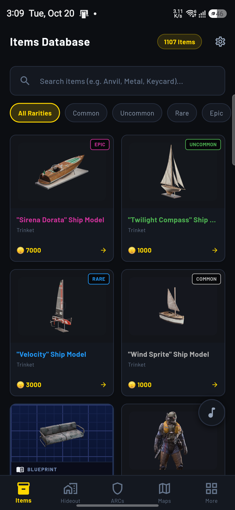
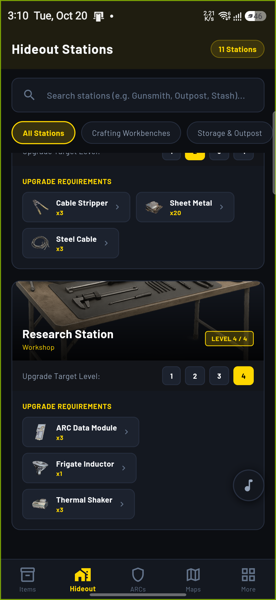
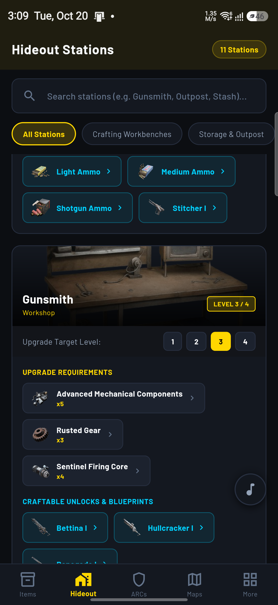
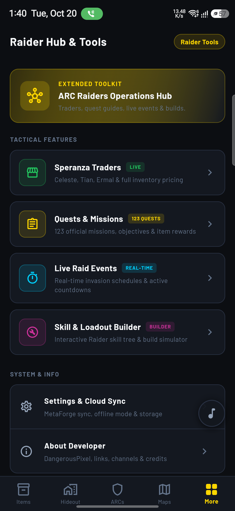
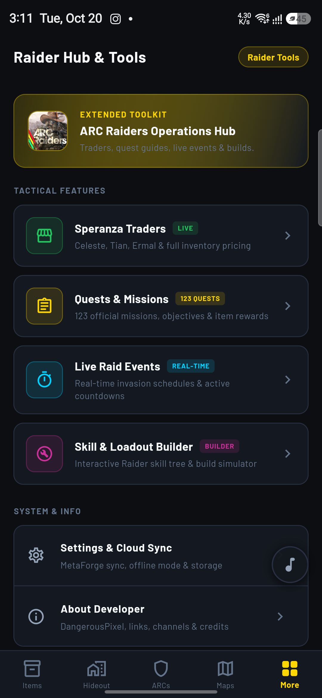

<p align="center">
  
</p>

<h1 align="center">⚡ ARC Raiders Companion</h1>

<p align="center">
  <b>The Definitive Multi-Platform Tactical Field Guide, Raid Timers & Workshop Database for ARC Raiders</b>
</p>

<p align="center">
  <a href="https://github.com/xDPixel/AR-Companion-Releases/releases/tag/v1.0.0"></a>
  <a href="#"></a>
  <a href="#"></a>
  <a href="#"></a>
</p>

---

## 📥 Official Downloads (v1.0.0)

All builds are standalone, production-ready, and compiled directly for their target architectures.

| Platform | Package Name | Format | Size | Download |
| :--- | :--- | :---: | :---: | :---: |
| 🪟 **Windows** | `ArcRaidersCompanion-Windows-Portable.zip` | Portable Zip (x64) | `40.6 MB` | [⬇️ Download](https://github.com/xDPixel/AR-Companion-Releases/releases/download/v1.0.0/ArcRaidersCompanion-Windows-Portable.zip) |
| 🍏 **macOS** | `ArcRaidersCompanion-macOS.dmg` | Disk Image (Universal) | `53.5 MB` | [⬇️ Download](https://github.com/xDPixel/AR-Companion-Releases/releases/download/v1.0.0/ArcRaidersCompanion-macOS.dmg) |
| 🐧 **Linux** | `ArcRaidersCompanion-Linux-x64.tar.gz` | Tarball (x86_64) | `38.4 MB` | [⬇️ Download](https://github.com/xDPixel/AR-Companion-Releases/releases/download/v1.0.0/ArcRaidersCompanion-Linux-x64.tar.gz) |
| 📱 **iOS** | `ArcRaidersCompanion-iOS.ipa` | Sideloadable IPA | `40.9 MB` | [⬇️ Download](https://github.com/xDPixel/AR-Companion-Releases/releases/download/v1.0.0/ArcRaidersCompanion-iOS.ipa) |
| 🤖 **Android** | `ArcRaidersCompanion-Android.apk` | Release APK (Universal) | `52.4 MB` | [⬇️ Download](https://github.com/xDPixel/AR-Companion-Releases/releases/download/v1.0.0/ArcRaidersCompanion-Android.apk) |

---

## 🌟 Key Features & Visual Showcase

### 1. 🛡️ Comprehensive ARC Items & Blueprints Database
> Instant search, full rarity spectrum, recycling yields, crafting values, and authentic in-game blueprint schematics.

<p align="center">
  
</p>

- **Dynamic Blueprint Identification**: Authentic blue-gridded technical display for all blueprint schematics under the dedicated `BluePrints` category.
- **Accurate In-Game Rarity Hierarchy**: Common (Grey), Uncommon (Green), Rare (Blue), Epic (`#CC3199` Magenta), and Legendary (Gold).
- **Deep Item Metadata**: Detailed drop locations, recycling component breakdown, merchant sell values, and weight stats.

---

### 2. 🛠️ Hideout Stations & Workshop Crafting Matrix
> Upgrade trees, craftable unlock previews, and deduplicated requirement matrices for all hideout facilities.

<p align="center">
  
  
</p>

- **Facilities Covered**: Gunsmith, Medical Lab, Explosives Depot, Outpost Station, Research Station, Gear Station, and Refiner.
- **Level Progression Tracker**: View exact materials required for Level 1, Level 2, and Level 3 upgrades.
- **Interactive Item Chips**: Tap any material requirement or unlocked weapon to view its full stats, drop sources, and crafting recipe instantly.
- **Deduplication Engine**: Clean, verified item requirements with zero duplicate chips across Outpost and Research stations.

---

### 3. ⏱️ Live Raid Event Timers & Server Regions
> Real-time raid event tracker with countdown clocks, active status indicators, and multi-region filtering.

<p align="center">
  
</p>

- **Real-Time Synchronized Clocks**: Countdown timers for active and upcoming surface events.
- **Regional Filtering**: Choose between Europe, North America, East Asia, Oceania, and South America to get server-accurate schedules.
- **Tactical Modifiers**: Stay prepared for EMP storms, night raids, heavy ARC activity, and high-value loot events.

---

### 4. 🧭 Raider Command Hub & Loadout Checklist
> Expedition departure rules, stash management reminders, and quick tactical shortcuts.

<p align="center">
  
</p>

- **Departure Rules**: Quick reference for what gear survives extraction and what risks are taken into the rust belt.
- **Offline-First Storage**: Local SQLite caching ensures all database entries and hideout blueprints load with zero latency even without an active internet connection.

---

## 🚀 Installation Instructions

### 🪟 Windows (Portable)
1. Download `ArcRaidersCompanion-Windows-Portable.zip`.
2. Extract the folder anywhere on your PC (e.g., `Desktop` or `Program Files`).
3. Launch `ArcRaidersCompanion.exe`. No installation or admin privileges required!

### 🍏 macOS
1. Download `ArcRaidersCompanion-macOS.dmg`.
2. Double-click the DMG and drag **ARC Raiders Companion** to your **Applications** folder.
3. *Note (Unnotarized Warning)*: If macOS displays *"Apple cannot check it for malicious software"*, open Terminal and run:
   ```bash
   xattr -cr /Applications/ArcRaidersCompanion.app
   ```
   Or right-click the app in Finder and choose **Open**.

### 🐧 Linux
1. Download `ArcRaidersCompanion-Linux-x64.tar.gz`.
2. Extract the archive:
   ```bash
   tar -xzf ArcRaidersCompanion-Linux-x64.tar.gz
   cd ArcRaidersCompanion-Linux-x64
   ./arc_raiders_companion
   ```

### 🤖 Android
1. Download `ArcRaidersCompanion-Android.apk`.
2. Open the file on your device.
3. Allow **Install from unknown sources** in Settings if prompted, then tap **Install**.

### 📱 iOS
1. Download `ArcRaidersCompanion-iOS.ipa`.
2. Sideload the IPA onto your iPhone or iPad using **AltStore**, **SideStore**, **TrollStore**, **Scarlet**, or Xcode.
3. Trust your developer profile under **Settings > General > VPN & Device Management**.

---

## ⚙️ Technical Architecture

- **UI Framework**: Flutter 3.24 & Material 3 Dark
- **State Management**: Provider / Riverpod architecture with reactive event streams
- **Database**: SQLite (via `sqflite`) with automatic migration scripts
- **Network Engine**: Custom HTTP client with exponential backoff and localized live event scraping
- **Design Language**: Custom ARC Raiders industrial UI palette featuring Barlow typography, authentic neon magenta (`#CC3199`) Epic styling, and technical grid blueprints.

---

## 📋 Changelog (v1.0.0)

- Initial multi-platform public release across Windows, macOS, Linux, iOS, and Android.
- Added live raid event timers with multi-region selector (Europe, N. America, E. Asia, Oceania, S. America).
- Added blue-gridded blueprint inspector matching the official ARC Raiders game aesthetic.
- Implemented deep item database with real-time search, filters, and full crafting recipes.
- Fixed deduplication of requirement items across Outpost and Research Stations.
- Added expedition departure stash checklists and overflow protection for small screens.

---

<p align="center">
  <i>ARC Raiders Companion is an unofficial fan-made project and is not affiliated with or endorsed by Embark Studios.</i>
</p>
